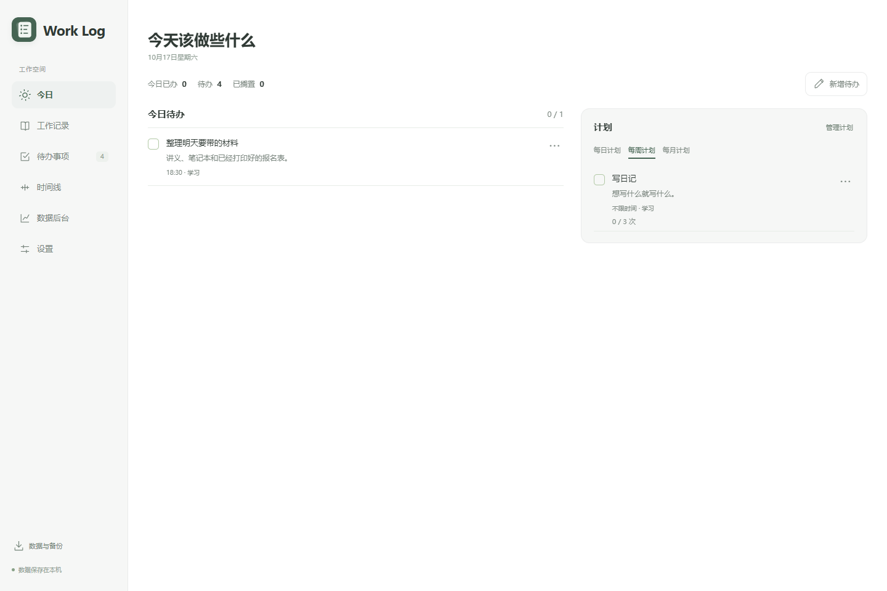
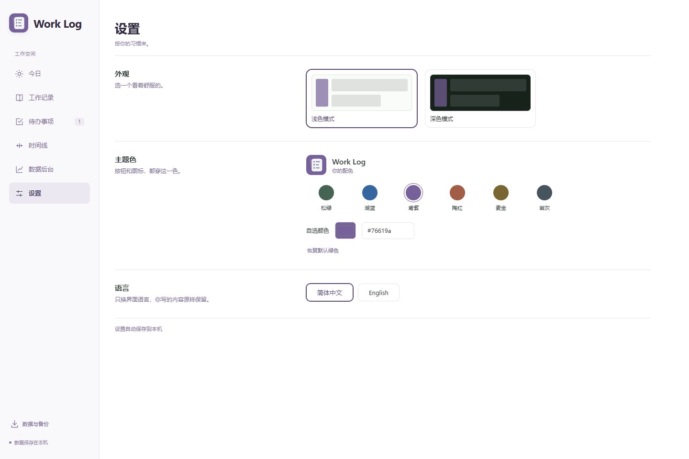
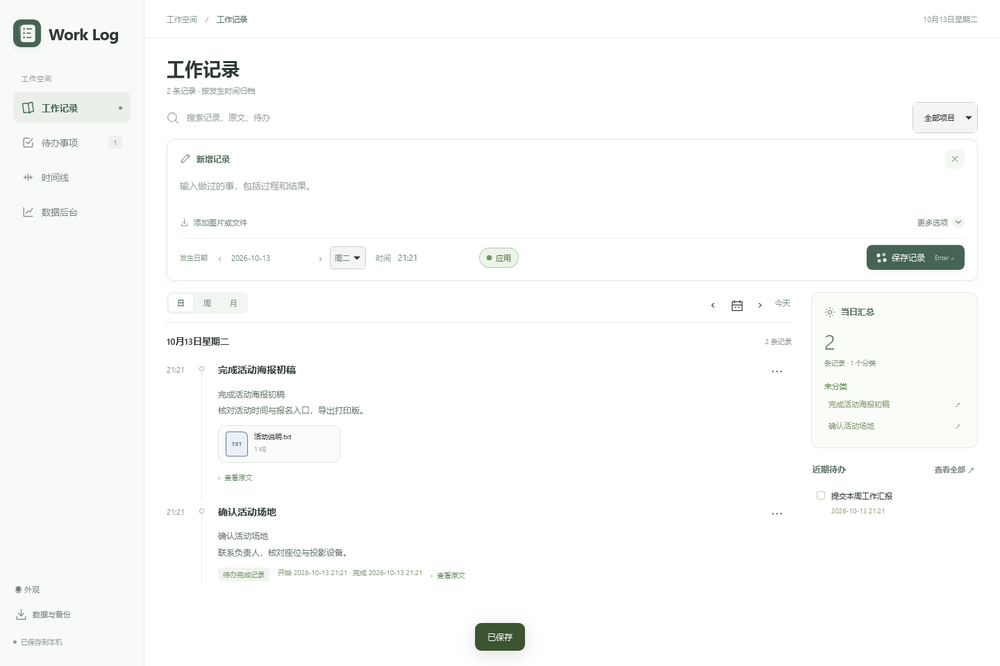
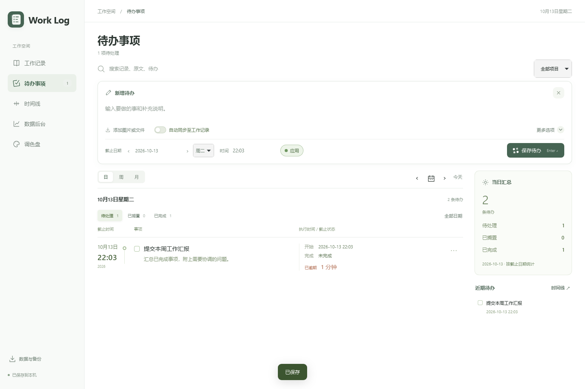
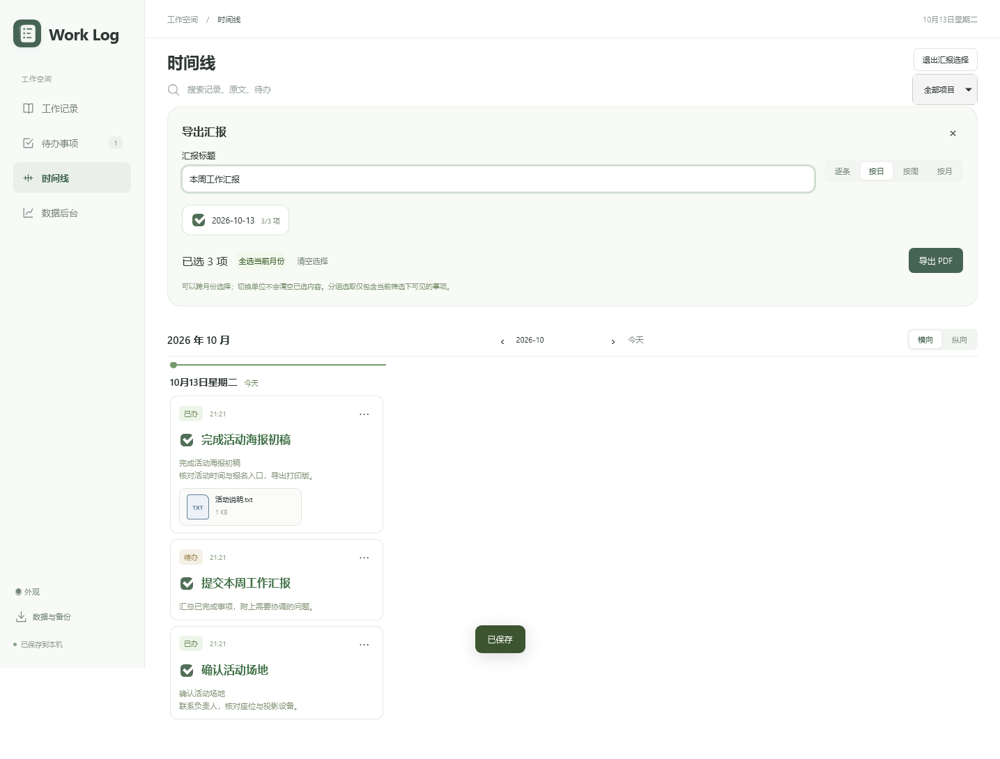
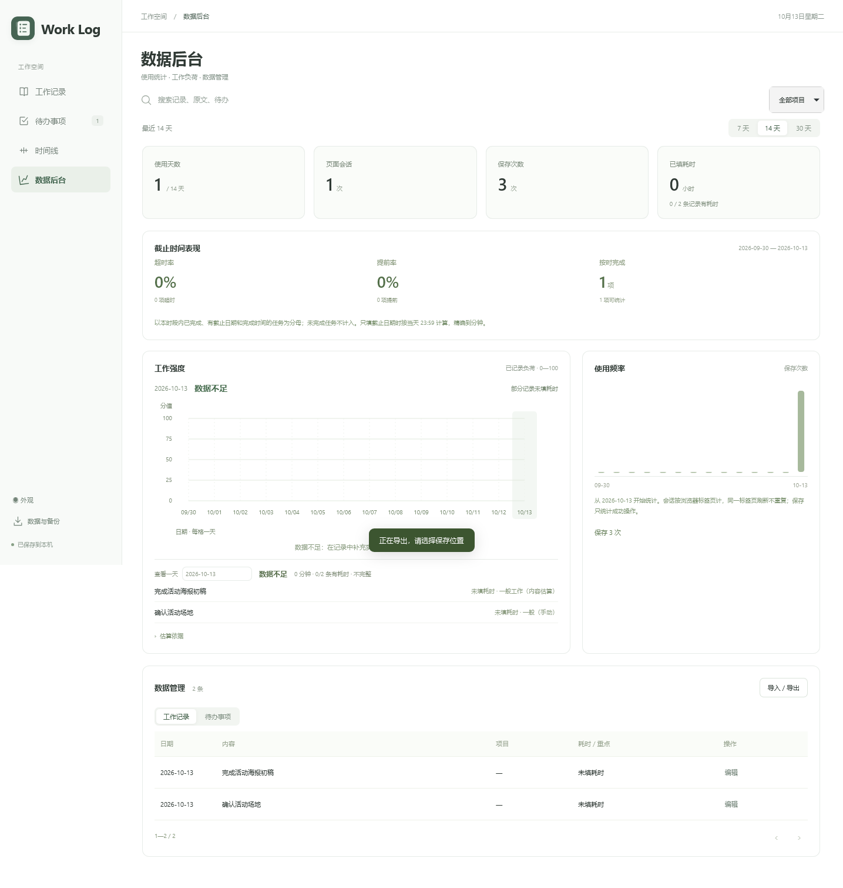

<div align="center">

# Work Log

A local-first work journal for people who say “I’ll remember this” and absolutely won’t. Record your work, review progress, manage tasks, and organize your timeline.

本机保存 · 工作记录 · 待办事项 · 时间线 · PDF 汇报

Local-first work journal & to-do app · Windows / macOS · Timeline · PDF export

[下载与版本](https://github.com/Benjamin-can-fly/I-swear-I-did-work/releases) · [安装说明](#下载与安装) · [参与开发](#开发与构建) · [MIT 许可证](LICENSE)

</div>



> 当前源码版本为 **0.2.13**。Windows、Apple 芯片 Mac、Intel Mac 分别由 GitHub 构建；当前在线接口改动按要求未在本机重新测试。下载以 [Releases](https://github.com/Benjamin-can-fly/I-swear-I-did-work/releases) 实际列出的版本为准。

[当前安装与使用说明](output/pdf/Work-Log-User-Guide.pdf)。Mac 的 `.pkg` 安装到“应用程序”，无需拖拽；目前没有 Apple Developer ID 签名和公证，首次安装或打开可能需要系统额外确认。

0.2.9 工作区：今日、待办事项和工作记录统一使用随手记；今日已办按实际完成日期合计并去重；使用频率图增加自适应刻度与圆角提示。

0.2.11 随手记可以将同一句里的多件事拆开，识别共用截止时间、单项优先级、开始时间、计划周期和次数。明确安排在本机直接解析，不需要下载模型；保存前可逐项修改预览。删除计划时清理当前及未来未完成项，完成记录和过去历史保留；菜单区分「删除本次」和「删除整个计划」。Windows 的窗口按钮固定在右上角，主题色同步到开始菜单和任务栏图标。

**0.2.13 的随手记只有一个入口。** 联网且模型就绪时，整段输入交给语言模型，生成事项与日期、优先级、周期、次数、前置任务等字段。结果收为“查看/修改”，需要时再展开。无网络时自动启用关键词识别与手动调整，重连不覆盖你改好的草稿。原话保留，保存仍由你决定。

“每周写一次作文”应保存为每周一次的计划；“先写作文，再检查一遍”形成前后关联。第一项完成后，后一项解锁并获得焦点；撤销完成后，未完成的后续事项恢复等待。模型不读取全部日志，也不直接修改任务库。[当前使用说明](docs/User-guide.md) · [PDF 使用说明](output/pdf/Work-Log-User-Guide.pdf)

## 可以做什么

| 功能 | 用法 |
| --- | --- |
| 随手记 | 在今日、待办或工作记录直接写，一段话可以拆成已办、待办和计划；[用法和在线模型](docs/Quick-capture.md) |
| 今日与计划 | 点击「今日已办」「待办」「已搁置」的数字可查看对应明细。每日／每周／每月计划可按次数或具体时刻安排，独立勾选并保留历史 |
| 设置 | 侧栏中的完整页面，集中调整主题色、浅色／深色模式和中英界面；英文单独配置字体，用户内容保持原样 |
| 工作记录 | 保存完整内容、发生时间、项目和附件，随时补记或修改 |
| 待办事项 | 今天的排在最前；今天之内先按重要程度，再按时间先后。可分别查看待处理、已搁置和已完成事项 |
| 完成后同步 | 每条待办可开启“自动同步至工作记录”，完成、修改和回退自动关联 |
| 后续任务 | “先写作文，再检查一遍”建立先后关系；前一步完成后自动定位下一步，也可以展开预览或修改事项调整关联 |
| 统一时间线 | 将过去的记录与未来安排放在一起，横向或纵向浏览 |
| PDF 汇报 | 按单条、日、周、月选择内容，跨月份组合成周报或阶段汇报 |
| 漏做与逾期 | 每日计划漏做按天统计，在数据后台首屏和时间线显示；24 小时内到期标黄，逾期标红 |
| 批量管理 | 工作记录和待办支持多选删除，15 秒内可撤销；沿用单向同步规则 |
| 数据与备份 | 查看使用统计，导出包含附件的 JSON 备份，迁移到另一台电脑 |

默认使用国内硅基流动提供的通义千问 Qwen3-8B，海外用户也可以选择 Gemini 2.5 Flash。模型都在线运行，不下载本地模型。首次使用展开“配置在线模型”，选择服务商并填写自己的 API 密钥。密钥只保存在自己的用户目录，不进入草稿或安装包。本次输入会发送给选定的服务商，全部历史日志不会发送；不会自动换服务商。免费额度、认证要求和限流以服务商账户为准，没有密钥时会明确提示。 [配置说明](docs/Local-language-model.md)。

新安装从空日志、空待办、空计划与默认设置开始。源代码、安装包均进行私人数据检查；个人数据库、附件、浏览器配置与密钥不打包。升级保留使用者自己的数据，迁移需要主动导入备份。验证范围见[0.2.13 验收记录](docs/ACCEPTANCE-0.2.13.md)。

## 待办与记录如何同步

待办与工作记录采用可选的单向同步：

- **同步由你决定。** 每条待办单独选择是否自动同步；开启后，完成事项生成对应工作记录。
- **同一件事，不写成两套故事。** 已同步待办的修改、回退、删除会更新对应记录，重复完成不会凭空多出一份。
- **独立记录有自己的边界。** 手动写下的工作记录不会反过来改动待办，避免两边相互覆盖。
- **没想设截止时间，就不催你。** 写“周五做”是安排在周五，写“周五前交”才是截止；也可以展开预览改日期，或在选项里指定截止时间。
- **周报不用重新回忆人生。** 按条、天、周、月选择时间线内容，导出保留原文的 PDF。

具体行为及验证范围见[需求核对与测试记录](docs/ACCEPTANCE-0.2.2.md)。

0.2.2 新增保留时间与开关设置的清空按钮、统一应用图标，并修正 Windows 高分屏窗口尺寸、优化启动流程：本机两次首帧响应约 0.9 秒，完整可操作约 3.3 秒，加载期间显示进度与等待时间。此前已修复已删除条目的旧编辑草稿无法保存、无截止时间待办的日期显示为空等问题。“数据与备份”中可查看当前版本。详见[需求核对与验证范围](docs/ACCEPTANCE-0.2.2.md)，完整操作见[使用说明 PDF](output/pdf/Work-Log-User-Guide.pdf)。

0.2.3 修复 Windows 桌面图标在重新启动后被旧缓存覆盖的问题，并同步仓库新名称。

0.2.4 增加今日首页和每日计划，压缩顶部窗口栏，取消启动读秒，并改善窗口居中与启动动画。

0.2.5 将调色盘整合为设置，新增深色模式和英文界面。颜色、明暗和语言分别保存；切换语言会保留编辑草稿与附件。日期、菜单、统计和 PDF 汇报使用所选语言，用户正文与文件名保持原样。

0.2.6 将设置改为侧栏中的完整页面，外观、主题色和语言分区排列。小窗口下随整页滚动；切换语言后仍停留在设置页，未保存的记录与待办草稿继续保留。今日页标题也跟随界面语言：中文为“今天该做些什么”，英文为“What to do today?”。

0.2.7 将每日／每周／每月计划整合进待办填写框，支持每周期多次、星期／日期／时刻和提前显示。今日页用一行文字显示进度；低频设置按需展开。见[本次调整、边界与回滚说明](docs/PLANS-0.2.7.md)。

0.2.8 统一简化六个页面：填写框默认只显示正文和必要操作，计划与附加设置按需展开，时间线、统计和设置使用一致的轻边框与留白。见[界面调整与回滚说明](docs/QUIET-WORKSPACE-0.2.8.md)。

## 下载与安装

打开 [Releases](https://github.com/Benjamin-can-fly/I-swear-I-did-work/releases)，在 **Assets** 中选择安装包。**Source code (zip)** 是开发源码，普通使用者无需下载。

| 你的电脑 | 安装包标识 | 兼容目标与验证情况 |
| --- | --- | --- |
| Windows，Intel / AMD 64 位电脑 | `windows-x64-setup.exe` | Windows 10 / 11；已在 Windows 11 本机验证，Windows 10 尚待单独验证 |
| Mac，苹果 M 系列芯片 | `macos-arm64.pkg` | macOS 13.5 及以上；在 macOS 15 ARM runner 构建与验证后发布 |
| Mac，Intel 芯片 | `macos-x64.pkg` | macOS 13.5 及以上；在 macOS 15 Intel runner 构建与验证后发布 |

Windows 32 位（x86）和 Windows ARM 原生版本暂不提供。同一处理器类型共用一个安装包，并注明系统范围；兼容目标不代表每一代系统均已实机验证。

**不知道 Mac 属于哪一种？** 苹果菜单 → 关于本机。显示“芯片 Apple M…”选苹果芯片版，显示“处理器 Intel…”选 Intel 版。[Apple 官方说明](https://support.apple.com/zh-cn/116943)

**Mac：** 下载 `.pkg` → 双击打开并按向导安装 → 从“应用程序”启动。偏好拖拽安装的用户也可以下载 `.dmg`。

**Windows：** 双击安装包并完成安装，在开始菜单搜索 **Work Log** 即可打开。可在「设置 → 应用 → 已安装的应用」中查看版本或卸载。无需打开浏览器、注册账号或安装 Node.js。

**Windows 系统提醒：** 为待办设置具体日期和时间，在该条随手记的展开选项里勾选「Windows 系统提醒」；定时计划也可以在「起止日期与提醒」里开启。Windows 会在所设时间发通知，点击后打开 Work Log 的「今日」。修改、完成或删除事项会相应更新提醒。已排入系统的提醒在退出软件后仍可送达；Work Log 每次打开时补排，从当天起最多排 30 天、保留最近的 64 次未来提醒。收不到横幅时，在「设置 → 系统 → 通知」里检查 Work Log，并检查是否开启了「勿扰」。电脑关机错过系统投递窗口时可能不会补弹。

预览包尚未完成 Windows 发布者签名，以及 Apple Developer ID 签名和公证，系统可能拦截首次打开。不要关闭系统安全保护；确认来源后依照 [Apple 官方打开说明](https://support.apple.com/zh-cn/102445) 处理，或等待签名版本。

### 用微信发给朋友

把对应系统的安装包拖进电脑版微信聊天发送即可。也可以发送 Release 页面链接，告诉朋友下载 Assets 中对应的安装包。

如果微信中无法下载，可复制链接到 Safari 或其他浏览器；若仍无法访问，你先下载正确安装包，再用微信发送文件。无需发送整个项目，也无需让朋友学习 GitHub。

## 界面预览

<details>
<summary><strong>设置：外观、主题色与界面语言</strong></summary>



</details>

<details>
<summary><strong>工作记录：保留过程、结果和附件</strong></summary>



</details>

<details>
<summary><strong>待办事项：截止时间、状态与自动同步</strong></summary>



</details>

<details>
<summary><strong>时间线：勾选事项并导出汇报</strong></summary>



</details>

<details>
<summary><strong>数据后台：统计、工作负荷与数据管理</strong></summary>



</details>

所有截图均使用示例数据。

## 常用操作

- 今日页集中显示今天的待办和每日计划；每日计划在“待办事项”里设置，每天的完成情况分别保留。
- 侧栏 → **设置**：调整主题色、浅色／深色模式和中英界面，选择自动保存在当前设备。切换语言不会翻译你写下的内容。
- 正文中 **Enter** 保存，**Ctrl + Enter** 换行，Mac 也支持 **Command + Enter**。
- 图片和文档可以拖进输入区，也可以点击“添加图片或文件”。
- 单击待办文字或勾选框标为完成；通过三点菜单修改、搁置或返回待处理。
- 新待办的“自动同步至工作记录”默认关闭。开启后，修改、回退、删除从待办单向同步到对应记录；工作记录的独立操作不会反向改动待办。
- 时间线 →“选择事项 · 导出汇报”：PDF 保留完整正文、状态、时间和附件名称，原附件不嵌入 PDF。

## 数据保存在你的电脑

| 运行方式 | 数据位置 |
| --- | --- |
| Windows 桌面版 | `%LOCALAPPDATA%\WorkJournal\data` |
| Mac 桌面版 | `~/Library/Application Support/WorkJournal/data` |
| 开发 / 原浏览器启动版 | 项目文件夹中的 `data` |

不同电脑不会自动同步。换电脑、迁移旧版或升级前，在“数据与备份”中导出 **JSON**，到另一端导入。JSON 包含所引用附件；PDF 和 Markdown 用于阅读，不替代完整备份。

程序仅监听本机地址，不是部署到公网的网站。安装包和仓库不包含开发者的个人记录。

## 开发与构建

需要 Node.js 22.9 或更新版本；发布构建固定使用 Node.js 24.18.0。

```sh
npm ci
npm start
```

开发页面：`http://127.0.0.1:4317`。日常桌面用户无需执行这些命令。

```sh
npm test
npx playwright install webkit
npm run test:webkit
```

**Windows 构建**（在 Windows 上）：

```powershell
powershell -NoProfile -ExecutionPolicy Bypass -File scripts/setup-desktop.ps1
npm run build:desktop
```

**Mac 构建**（在对应架构的 Mac 上，需 Xcode Command Line Tools 与 Python 3.12）：

```sh
python3 scripts/build-macos.py --arch arm64   # 苹果芯片
python3 scripts/build-macos.py --arch x64     # Intel
```

Mac 构建会校验运行环境下载文件，编译原生窗口，运行实际保存和 PDF 导出测试，然后生成 `.dmg`。测试失败不产出安装包。

没有 Mac 的开发者可在 GitHub **Actions → Build desktop previews → Run workflow** 构建。三个任务分别生成 Windows x64、Mac arm64、Mac x64 包；构建结果是 Actions artifacts，维护者检查通过后再附加到 Release，不会自动发布。

## 参与项目

欢迎通过 [Issues](https://github.com/Benjamin-can-fly/I-swear-I-did-work/issues) 报告问题或提出功能建议。请说明系统、软件版本、操作步骤和预期结果；截图请先去掉私人信息，不要提交个人备份或密钥。

提交修改前运行相关测试。界面、数据模型和本机服务共用同一套源码；Windows 与 Mac 仅在原生窗口、文件保存和打包入口上区分。

## 许可证

[MIT](LICENSE) · Copyright © 2026 Benjamin-can-fly

第三方组件保留各自许可证，见 [第三方说明](THIRD-PARTY-NOTICES.md)。
