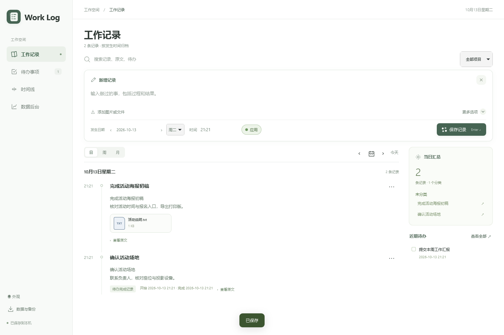
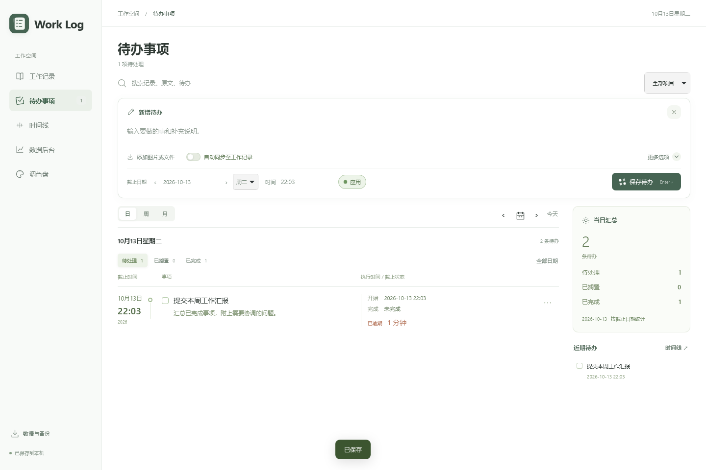
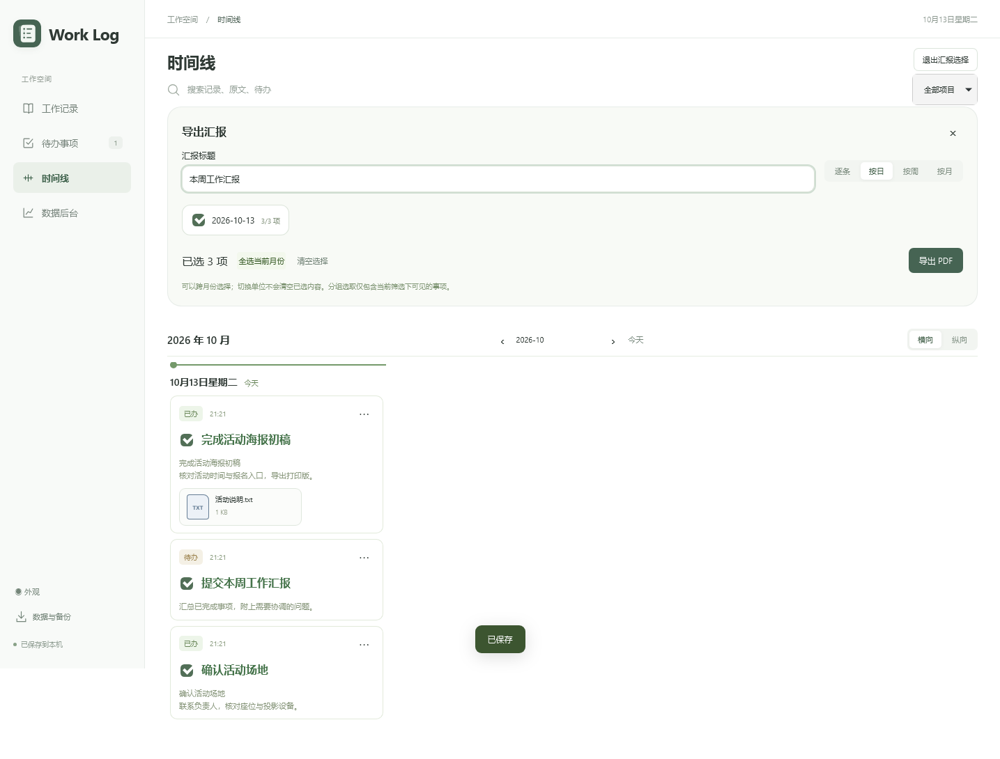
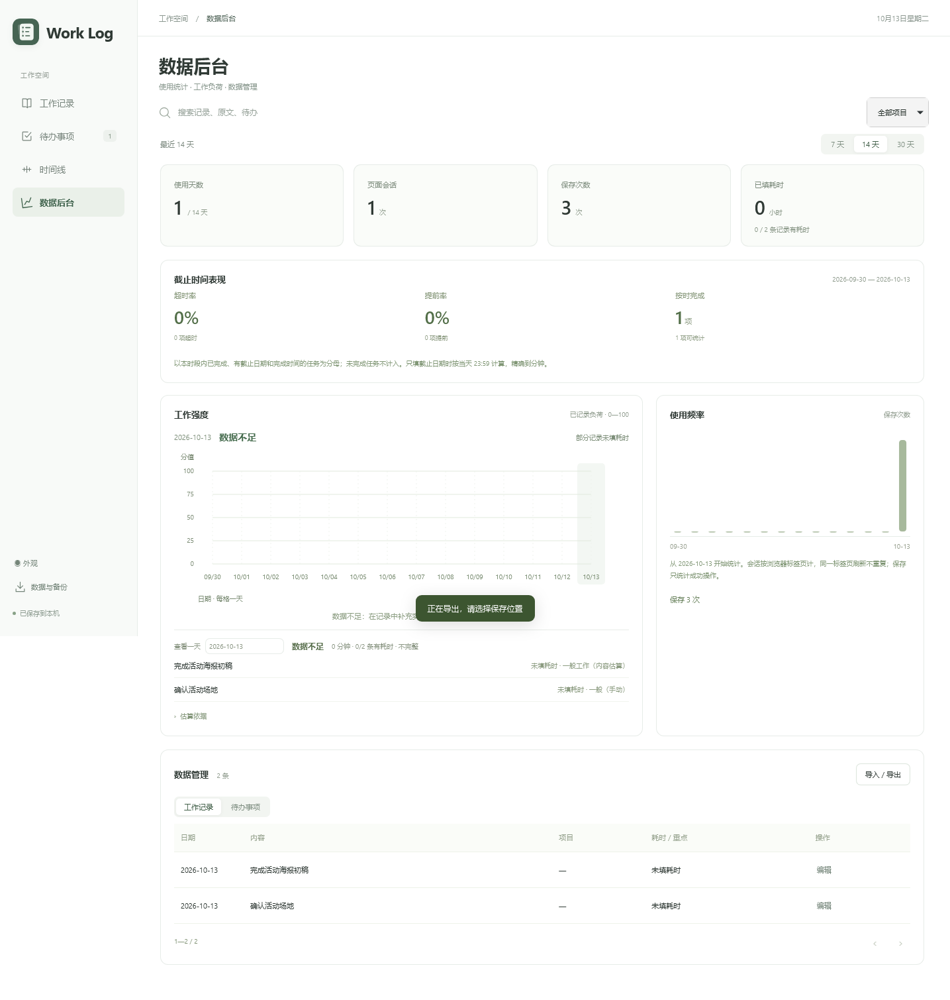

<div align="center">

# Work Log

**记录做过的事，安排要做的事，按时间整理成汇报。**

本机保存 · 工作记录 · 待办事项 · 时间线 · PDF 汇报

[下载与版本](https://github.com/Benjamin-can-fly/work-journal/releases) · [安装说明](#下载与安装) · [参与开发](#开发与构建) · [MIT 许可证](LICENSE)

</div>



> 软件名称为 Work Log，使用绿色记录页与时间节点图标。Windows x64 已完成本机安装及导出测试；Mac 的适配代码和自动构建流程已加入，安装包仅在 Mac 构建、运行测试通过后提供。请以 Releases 实际列出的附件为准。

## 可以做什么

| 功能 | 用法 |
| --- | --- |
| 工作记录 | 保存完整内容、发生时间、项目和附件，随时补记或修改 |
| 待办事项 | 截止日期与星期联动，查看待处理、已搁置和已完成事项 |
| 完成后同步 | 每条待办可开启“自动同步至工作记录”，完成、修改和回退自动关联 |
| 统一时间线 | 将过去的记录与未来安排放在一起，横向或纵向浏览 |
| PDF 汇报 | 按单条、日、周、月选择内容，跨月份组合成周报或阶段汇报 |
| 数据与备份 | 查看使用统计，导出包含附件的 JSON 备份，迁移到另一台电脑 |

无需配置模型或 API 密钥。当前不提供 AI 总结；保存和导出你填写的内容。

0.2.2 新增保留时间与开关设置的清空按钮、统一应用图标，并修正 Windows 高分屏窗口尺寸、优化启动流程：本机两次首帧响应约 0.9 秒，完整可操作约 3.3 秒，加载期间显示进度与等待时间。此前已修复已删除条目的旧编辑草稿无法保存、无截止时间待办的日期显示为空等问题。“数据与备份”中可查看当前版本。详见[需求核对与验证范围](docs/ACCEPTANCE-0.2.2.md)，完整操作见[使用说明 PDF](output/pdf/工作日志使用说明.pdf)。

## 下载与安装

打开 [Releases](https://github.com/Benjamin-can-fly/work-journal/releases)，在 **Assets** 中选择安装包。**Source code (zip)** 是开发源码，普通使用者无需下载。

| 你的电脑 | 安装包标识 | 兼容目标与验证情况 |
| --- | --- | --- |
| Windows，Intel / AMD 64 位电脑 | `windows-x64-setup.exe` | Windows 10 / 11；已在 Windows 11 本机验证，Windows 10 尚待单独验证 |
| Mac，苹果 M 系列芯片 | `macos-arm64.dmg` | macOS 13.5 及以上；需 Mac 构建与运行测试通过后发布 |
| Mac，Intel 芯片 | `macos-x64.dmg` | macOS 13.5 及以上；需 Mac 构建与运行测试通过后发布 |

Windows 32 位（x86）和 Windows ARM 原生版本暂不提供。同一处理器类型共用一个安装包，并注明系统范围；兼容目标不代表每一代系统均已实机验证。

**不知道 Mac 属于哪一种？** 苹果菜单 → 关于本机。显示“芯片 Apple M…”选苹果芯片版，显示“处理器 Intel…”选 Intel 版。[Apple 官方说明](https://support.apple.com/zh-cn/116943)

**Mac：** 下载 `.dmg` → 双击打开 → 把“Work Log.app”拖到 **Applications / 应用程序** → 从应用程序启动。

**Windows：** 下载 `.exe` → 打开安装向导 → 选择安装位置 → 安装后从桌面快捷方式打开。无需自行安装 Node.js；缺少 WebView2 时会提示安装微软组件。

预览包尚未完成 Windows 发布者签名，以及 Apple Developer ID 签名和公证，系统可能拦截首次打开。不要关闭系统安全保护；确认来源后依照 [Apple 官方打开说明](https://support.apple.com/zh-cn/102445) 处理，或等待签名版本。

### 用微信发给朋友

把对应系统的安装包拖进电脑版微信聊天发送即可。也可以发送 Release 页面链接，告诉朋友下载 Assets 中对应的安装包。

如果微信中无法下载，可复制链接到 Safari 或其他浏览器；若仍无法访问，你先下载正确安装包，再用微信发送文件。无需发送整个项目，也无需让朋友学习 GitHub。

## 界面预览

<details>
<summary><strong>待办事项：截止时间、状态与自动同步</strong></summary>



</details>

<details>
<summary><strong>时间线：勾选事项并导出汇报</strong></summary>



</details>

<details>
<summary><strong>数据后台：统计、工作负荷与数据管理</strong></summary>



</details>

所有截图均使用示例数据。

## 常用操作

- 正文中 **Enter** 保存，**Ctrl + Enter** 换行，Mac 也支持 **Command + Enter**。
- 图片和文档可以拖进输入区，也可以点击“添加图片或文件”。
- 单击待办文字或勾选框标为完成；通过三点菜单修改、搁置或返回待处理。
- 新待办的“自动同步至工作记录”默认关闭。开启后，修改、回退、删除从待办单向同步到对应记录；工作记录的独立操作不会反向改动待办。
- 时间线 →“选择事项 · 导出汇报”：PDF 保留完整正文、状态、时间和附件名称，原附件不嵌入 PDF。

## 数据保存在你的电脑

| 运行方式 | 数据位置 |
| --- | --- |
| Windows 桌面版 | `%LOCALAPPDATA%\WorkJournal\data` |
| Mac 桌面版 | `~/Library/Application Support/WorkJournal/data` |
| 开发 / 原浏览器启动版 | 项目文件夹中的 `data` |

不同电脑不会自动同步。换电脑、迁移旧版或升级前，在“数据与备份”中导出 **JSON**，到另一端导入。JSON 包含所引用附件；PDF 和 Markdown 用于阅读，不替代完整备份。

程序仅监听本机地址，不是部署到公网的网站。安装包和仓库不包含开发者的个人记录。

## 开发与构建

需要 Node.js 22.9 或更新版本；发布构建固定使用 Node.js 24.18.0。

```sh
npm ci
npm start
```

开发页面：`http://127.0.0.1:4317`。日常桌面用户无需执行这些命令。

```sh
npm test
npx playwright install webkit
npm run test:webkit
```

**Windows 构建**（在 Windows 上）：

```powershell
powershell -NoProfile -ExecutionPolicy Bypass -File scripts/setup-desktop.ps1
npm run build:desktop
```

**Mac 构建**（在对应架构的 Mac 上，需 Xcode Command Line Tools 与 Python 3.12）：

```sh
python3 scripts/build-macos.py --arch arm64   # 苹果芯片
python3 scripts/build-macos.py --arch x64     # Intel
```

Mac 构建会校验运行环境下载文件，编译原生窗口，运行实际保存和 PDF 导出测试，然后生成 `.dmg`。测试失败不产出安装包。

没有 Mac 的开发者可在 GitHub **Actions → Build desktop previews → Run workflow** 构建。三个任务分别生成 Windows x64、Mac arm64、Mac x64 包；构建结果是 Actions artifacts，维护者检查通过后再附加到 Release，不会自动发布。

## 参与项目

欢迎通过 [Issues](https://github.com/Benjamin-can-fly/work-journal/issues) 报告问题或提出功能建议。请说明系统、软件版本、操作步骤和预期结果；截图请先去掉私人信息，不要提交个人备份或密钥。

提交修改前运行相关测试。界面、数据模型和本机服务共用同一套源码；Windows 与 Mac 仅在原生窗口、文件保存和打包入口上区分。

## 许可证

[MIT](LICENSE) · Copyright © 2026 Benjamin-can-fly

第三方组件保留各自许可证，见 [第三方说明](THIRD-PARTY-NOTICES.md)。


### 外观与紧凑布局

导航「数据后台」下面的「调色盘」可选择预设或自定义颜色。界面与图标同时换色，选择保存在当前设备。Windows 桌面图标跟随已安装应用更新；Mac Dock 图标随界面更新，Finder 安装图标保持默认绿色。

时间线导出入口位于标题右侧；日期栏与任务卡片收紧，完成方框缩小并保留点击范围。Windows 窗口操作整合进界面；Mac 保留系统红黄绿按钮、隐藏重复标题。
